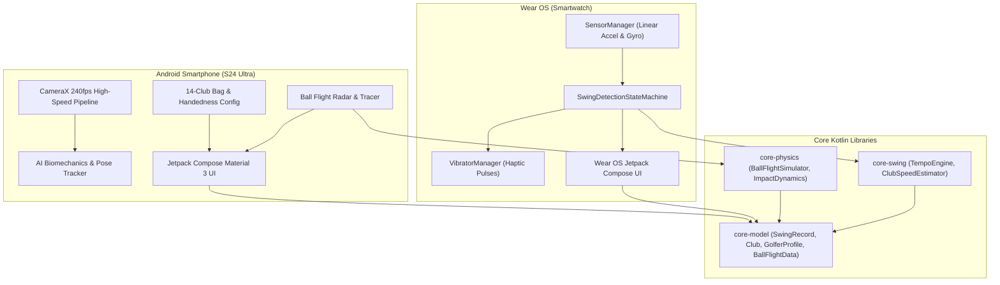

# ⛳ GolfGod

> **Intelligent Golf Swing Analysis, Ball Flight Launch Monitor & AI Biomechanics Coach**  
> Built for **Android Smartphones** (optimized for Samsung Galaxy S24 Ultra) & **Wear OS Smartwatches** (Samsung Galaxy Watch 4 / 5 / 6 / 7 / Ultra).

---

## 👨‍💻 Creator & Credits

- **Creator & Lead Architect:** **Dr. Timothy Tok**
- **Project:** **GolfGod**
- **Repository:** [https://github.com/drtim83/GolfGod](https://github.com/drtim83/GolfGod)

---

## 🌟 Key Features

### 1. ⌚ Real-Time Wear OS Smartwatch IMU Tracking
- **High-Frequency Sensor Sampling:** Continuously polls linear acceleration (`TYPE_LINEAR_ACCELERATION`) and gyroscope (`TYPE_GYROSCOPE`) at maximum speed (`SENSOR_DELAY_FASTEST`, up to 200 Hz).
- **Multi-Stage Swing State Machine:** 7-phase finite state machine (`ADDRESS` ➔ `BACKSWING` ➔ `TOP_OF_SWING` ➔ `DOWNSWING` ➔ `IMPACT` ➔ `FOLLOW_THROUGH` ➔ `FINISH`) to eliminate false triggers from practice waggles.
- **Haptic Bio-Feedback:** Distinct vibration pulses on your wrist at the top of the backswing and through impact to establish rhythm and prevent rushing transitions.
- **Live On-Wrist Readouts:** Shows instantaneous club selection, tempo ratio, estimated clubhead speed, and swing count.

### 2. ⚡ Tour-Benchmark 3.0:1 Tempo Engine
- **Precise Millisecond Timing:** Independently clocks backswing duration (e.g. 720 ms) and downswing duration (e.g. 240 ms).
- **Cadence Scoring:** Benchmarks every swing against the PGA Tour standard **3.0 : 1** ratio with instant qualitative feedback (`PERFECT`, `RUSHED`, `TOO_SLOW`, `OVER_SWING`).

### 3. 📹 240 FPS AI Vision Swing Coach
- **High-Speed Camera Pipeline:** Native 240 FPS down-the-line video capture (57+ crisp frames per downswing).
- **33-Point Biomechanical Joint Analysis:**
  - **Spine Angle Retention:** Tracks posture from setup through impact.
  - **X-Factor Kinematic Sequence:** Calculates differential between shoulder rotation (90°+) and hip rotation (~45°).
  - **Pelvis Early Extension Alert:** Flags lateral hip drift toward the ball that causes blocks, flips, and thin strikes.
  - **P6 Club Shaft Plane:** Analyzes delivery angle entering the impact zone.
- **Interactive Drill Prescription:** Generates tailored corrective drills (e.g. *The Glute Wall & Chair Drill*) based on detected mechanical faults.

### 4. 📊 Aerodynamic Ball Flight Launch Monitor & Radar
- **Physics-Based Simulation:** Calculates trajectory using numerical aerodynamic differential equations incorporating atmospheric drag ($C_d$) and Magnus lift ($C_l$).
- **Launch Metrics:**
  - Ball Speed & Clubhead Speed
  - Smash Factor (club loft & restitution efficiency)
  - Launch Angle (degrees) & Backspin (RPM)
  - Apex Height (ft), Carry Distance (yds), Roll (yds), and Total Distance
- **Range Flight Tracer:** Interactive visual 2D flight path display against yardage markers.

### 5. 🎒 14-Club Distance Gapping & Dual-Handedness (RH / LH)
- **Full Bag Roster:** Configured for Driver, Fairway Woods (3W, 5W), Hybrid (3H), Irons (4I–9I), and Wedges (PW, GW, SW, LW) with factory lofts, shaft lengths, typical carry, and target tempos.
- **Handedness & Wrist Calibration:**
  - Seamless toggle between **Right-Handed (RH)** and **Left-Handed (LH)** golfers.
  - Gyroscope axis inversion and lead-vs-trail wrist sensor alignment (Left Wrist vs. Right Wrist).

---

## 🏛️ System Architecture

GolfGod is engineered using a decoupled, modular multi-project architecture designed for clean separation of concerns, high testability, and zero UI coupling with physics:



### Module Breakdown

1. **`app-phone` (Android Phone Application)**
   - UI layer built with Jetpack Compose & Material 3.
   - 5 Main Navigation Portals: Range, AI Coach, Ball Flight Radar, Bag & Handedness, and History.
   - High-framerate camera preview and biomechanical pose overlays.

2. **`app-wear` (Wear OS Smartwatch Application)**
   - Wear OS Compose UI optimized for circular displays (Galaxy Watch).
   - High-throughput IMU listener with minimal battery overhead and low latency.
   - Direct haptic feedback engine.

3. **`core-model` (Pure Kotlin Domain Models)**
   - Data models: `SwingRecord`, `Club`, `GolferProfile`, `BallFlightData`, `CoachFeedback`, `PoseAnalysis`, `SessionData`, and `StandardBag`.

4. **`core-swing` (Swing Dynamics & Detection Engine)**
   - `SwingDetectionStateMachine`: Real-time phase transitions.
   - `TempoEngine`: Millisecond backswing/downswing ratio calculation.
   - `ClubSpeedEstimator`: Angular velocity to linear clubhead speed transformation based on arm length and shaft length.

5. **`core-physics` (Aerodynamics & Impact Simulator)**
   - `BallFlightSimulator`: Numerical ball flight integration with aerodynamic drag and Magnus force.
   - `ImpactDynamics`: Collision physics modeling smash factor, dynamic loft, and launch conditions.

---

## 💻 Tech Stack

| Domain | Technology / Library | Description |
| :--- | :--- | :--- |
| **Language** | Kotlin 1.9+ | Modern, concise, and null-safe language across all modules |
| **Build System** | Gradle 8.x + AGP 8.x | Multi-module Android Gradle build with optimized caching |
| **Phone UI** | Jetpack Compose + Material 3 | Declarative UI, reactive state management, custom canvas animations |
| **Wear OS UI** | AndroidX Wear Compose | Compose Material for circular smartwatch watchfaces |
| **Sensors** | Android SensorManager | Hardware linear accelerometer and gyroscope at `SENSOR_DELAY_FASTEST` |
| **Haptics** | AndroidX Vibrator / VibratorManager | Waveform haptic feedback for swing tempo guidance |
| **Computer Vision** | CameraX / MediaCodec | High-speed 240 FPS capture pipeline on supported hardware |
| **Physics** | Pure Kotlin Numerical Methods | Aerodynamic differential equations, Magnus effect, ballistic trajectory |
| **Compatibility** | Min SDK 28 (Android 9.0) / Target SDK 34 | Supports modern Android flagships and Wear OS 3.0+ |

---

## 📱 Pre-Built Release APK Locations

The release APKs are pre-compiled and ready for deployment:

| Target Device | APK File Path | Size |
| :--- | :--- | :--- |
| **Android Phone** | [`app-phone/build/outputs/apk/release/app-phone-release.apk`](file:///Users/drtimothytok/VibeCoding/GolfGod/app-phone/build/outputs/apk/release/app-phone-release.apk) | ~10.2 MB |
| **Wear OS Watch** | [`app-wear/build/outputs/apk/release/app-wear-release.apk`](file:///Users/drtimothytok/VibeCoding/GolfGod/app-wear/build/outputs/apk/release/app-wear-release.apk) | ~16.7 MB |

---

## 🚀 How to Install & Sideload the APKs

### Part 1: Installing on Android Phone (`app-phone-release.apk`)

#### Method A: Via USB & ADB (Recommended for Developers)
1. Connect your Android phone to your computer via USB.
2. Verify **USB Debugging** is enabled in your phone's *Developer Options*.
3. From the project root, run:
   ```bash
   adb install -r app-phone/build/outputs/apk/release/app-phone-release.apk
   ```

#### Method B: Direct Sideloading (No PC Required)
1. Transfer `app-phone-release.apk` to your phone via **Quick Share**, Google Drive, or USB.
2. In your phone's file browser (e.g. **My Files**), tap the APK file.
3. If prompted with *"Install unknown apps"*, tap **Settings** and toggle **Allow from this source**.
4. Confirm **Install** and launch **GolfGod**.

---

### Part 2: Installing on Samsung Galaxy Watch / Wear OS (`app-wear-release.apk`)

#### Step 1: Enable Wireless Debugging on your Watch
1. On your Galaxy Watch, open **Settings** ⚙️.
2. Go to **About watch** > **Software info**.
3. Tap **Software version** 7 times until you see *"Developer mode turned on"*.
4. Return to **Settings** and scroll down to the new **Developer options** menu.
5. Turn ON **ADB debugging**.
6. Turn ON **Wireless debugging**.
   > 📌 *Note: Your watch and computer (or phone) must be connected to the exact same Wi-Fi network.*

#### Step 2: Sideloading via Mac / PC (Wireless ADB)
1. Under **Wireless debugging** on your watch, tap **Pair new device**.
   - Note the **IP address**, **Pairing Port**, and the **6-digit pairing code**.
2. In your Mac/PC terminal, pair with the watch:
   ```bash
   adb pair <WATCH_IP>:<PAIRING_PORT>
   # Enter the 6-digit pairing code when prompted
   ```
3. Return to the main Wireless Debugging screen on the watch to get the primary connection port, then connect:
   ```bash
   adb connect <WATCH_IP>:<CONNECTION_PORT>
   ```
4. Verify the connection:
   ```bash
   adb devices
   ```
5. Install the Wear OS app:
   ```bash
   adb install -r app-wear/build/outputs/apk/release/app-wear-release.apk
   ```

#### Step 3: Alternative Phone-to-Watch Sideloading (No PC Needed)
1. Install **Bugjaeger Mobile ADB** or **GeminiMan Wear OS Manager** from Google Play Store onto your phone.
2. Transfer `app-wear-release.apk` to your phone's storage.
3. Open Bugjaeger, connect to your watch IP via Wireless Debugging, select the APK, and tap **Install**.

#### Step 4: Grant Permissions
When opening GolfGod on your watch for the first time, allow **Body Sensors / Physical Activity** permissions to enable the IMU motion tracking.

---

## 🏗️ Building from Source

```bash
# Clone the repository
git clone https://github.com/drtim83/GolfGod.git
cd GolfGod

# Verify build graph with a dry run
./gradlew assembleRelease --dry-run

# Build Release APKs
./gradlew assembleRelease

# Build Debug APKs
./gradlew assembleDebug
```

> **JDK Runtime:** Automatic fallback is configured to detect and use Android Studio's bundled OpenJDK runtime on macOS if `JAVA_HOME` is not explicitly exported.

---

## 📄 License & Credits

Designed and developed by **Dr. Timothy Tok**.  
All rights reserved.
